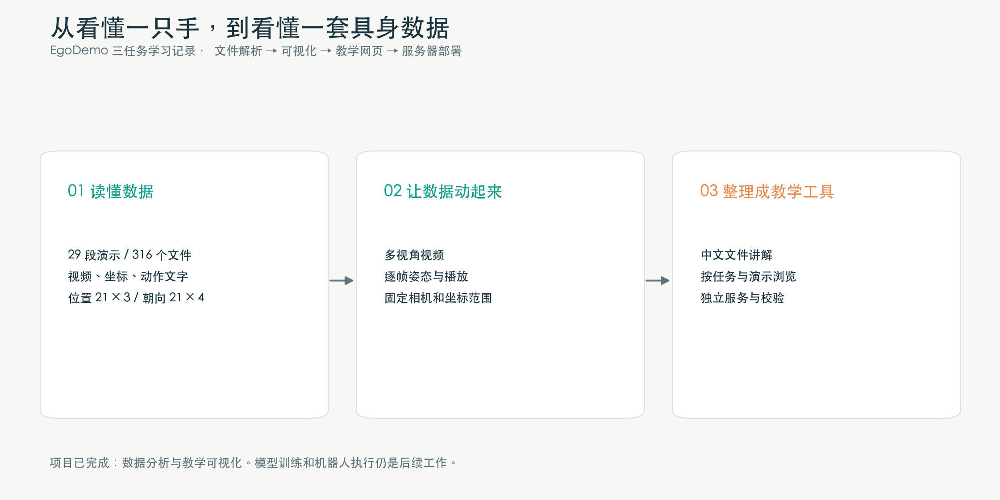
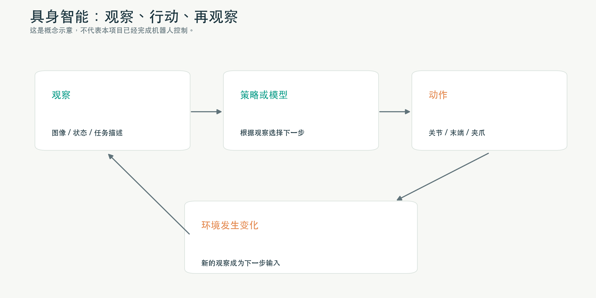
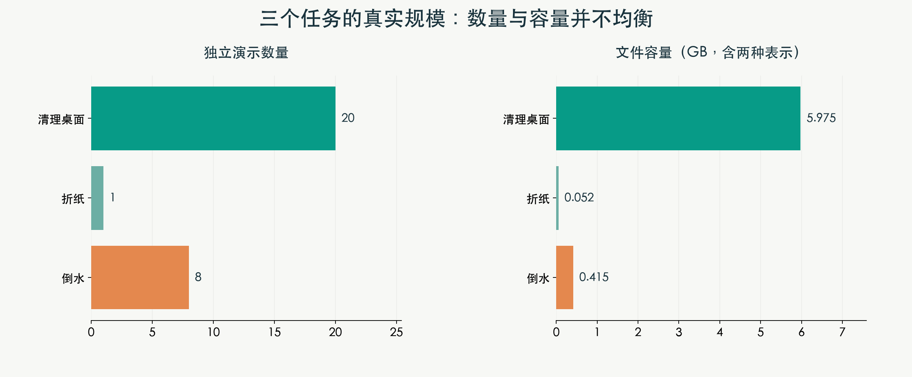
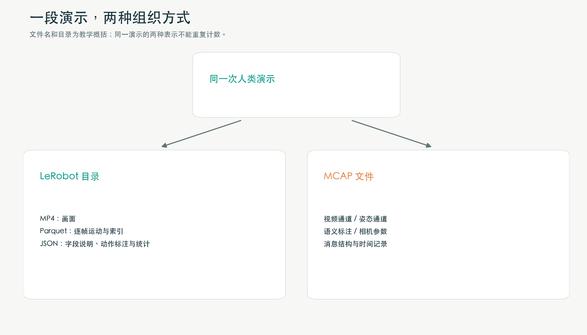
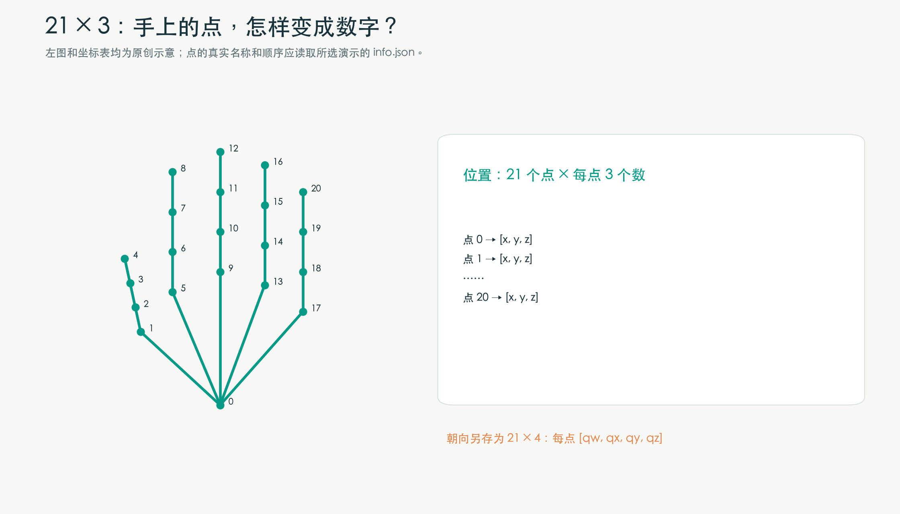
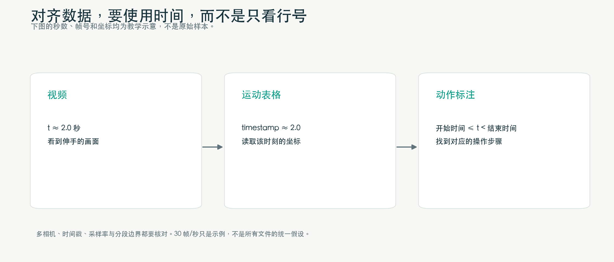
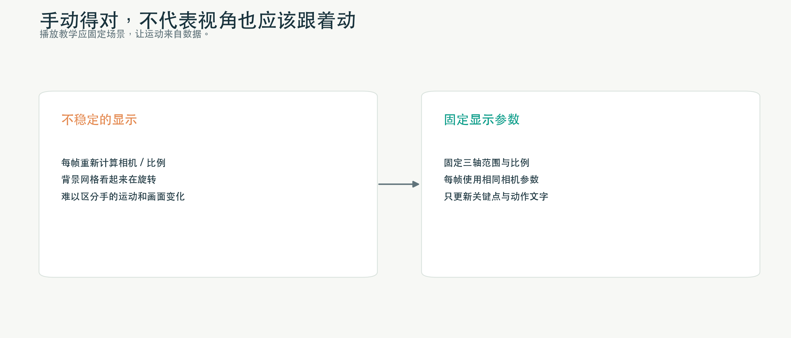
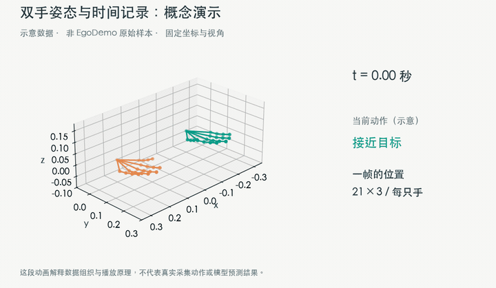
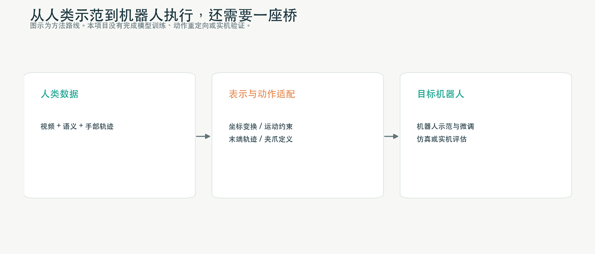

# 从 Parquet 到会动的双手：我的 EgoDemo 具身智能数据入门实践

> 一次从“这些文件怎么打开”开始的学习：理解第一人称人类示范，选取三个任务，解析视频与姿态，搭建中文教学网页，再部署到服务器。
>
> 本文面向刚接触具身智能和机器人数据的读者。项目记录整理于 2026 年 10 月 21 日。文中配图和动画为原创教学示意；动画使用合成数据，不是 EgoDemo 原始采集片段，也不是模型预测结果。



刚接触 EgoDemo 时，我最先遇到的问题很具体：

- 为什么一个数据集里面，既有 MP4，又有 Parquet、JSON 和 MCAP？
- 页面里写着 `21×3`，这到底是 21 个什么？
- 手部坐标能画出来，能不能让它像视频一样播放？
- 把人做事的视频给模型看，机器人是不是就能学会操作？

这些问题看起来零碎，实际上都指向同一个目标：**把“一个人做了一件事”，转换成能理解、能检查、能被程序使用的数据。**

这次，我借助辅助开发工具，围绕 EgoDemo 完成了一条小而完整的学习路线：

```text
了解数据集 → 选取三个任务 → 下载并校验
    → 查看原始文件 → 播放视频 → 可视化手部姿态
    → 制作中文教学网页 → 部署为服务器服务
```

先说明项目边界：这次完成的是**数据理解、解析和教学可视化**。我没有在这三个任务上训练 VLA，没有完成机器人动作重定向，也没有验证实机任务成功率。

---

## 一、补一堂基础课：具身智能的数据，为什么与普通图片不同？

### 1. 从“看懂”走到“行动”

识别一张照片里的杯子，与控制机械臂拿起杯子，是两个难度不同的问题。

图片识别主要回答“这是什么”。机器人操作还需要回答：杯子在哪里？怎样接近？什么时候合拢夹爪？拿起后是否滑落？下一步应该如何调整？

具身智能可以从一个简单循环理解：

```text
观察环境 → 选择动作 → 执行动作 → 环境变化 → 获得新的观察
```



因此，数据不只要记录“有什么”，还要尽可能记录“什么时候发生了什么、身体怎样运动、观察和动作怎样对应”。

不同项目提供的信息并不相同。研究时不能只看到“多模态”三个字，就假设一定有深度、力觉、触觉或机器人控制指令。

### 2. 先认识六个常用词

| 术语 | 通俗理解 | 在这次项目里的例子 |
|---|---|---|
| Task，任务 | 要完成的事情 | 清理桌面、折纸、倒水 |
| Episode，演示片段 | 一次实际操作记录 | 某个人完成一次清理桌面 |
| Frame，帧 | 视频的一幅画面，或数据中的一个采样时刻 | 某个时刻的双手坐标 |
| Observation，观察 | 模型当时能够获得的信息 | 摄像头画面、任务文字、可用状态 |
| Action，动作 | 学习系统需要预测或执行的量 | 机器人末端位移、关节目标、夹爪开合等 |
| Annotation，标注 | 为原始记录补充的说明或参考信息 | 某段时间正在收集纸屑 |

这里有一个重要区别：**观察中出现的人类运动状态，不会因为被存进表格，就自动成为机器人可以执行的 action。**

### 3. “看到了什么”“正在做什么”“接下来怎么动”

一个动作过程可以有多种互相补充的描述：

- 视频提供外观和视觉运动信息。
- 姿态提供身体或手部的空间位置、朝向。
- 文字标注提供任务和步骤的含义。
- 时间戳帮助把不同信息放到同一条时间线上。

这就是我理解“多模态”的起点：不是文件类型多，而是同一个过程有多种描述，并且这些描述能建立对应关系。

---

## 二、EgoDemo 是什么？先把规模和范围弄清楚

EgoDemo 是 Lightwheel 发布的 EgoSuite-Open100K 系列中的约 50 小时样例集。它包含带标注的人类第一人称操作记录，也包含原始视频变体。**系列规划的十万小时，与这个样例集的五十小时是不同范围。** 官方页面还特别说明，完整合集的任务、场景覆盖数字不能直接算到 EgoDemo 上。[官方数据集说明](https://huggingface.co/datasets/LightwheelAI/EgoDemo)

“第一人称”可以想象成把摄像头戴在头上：拍到的是操作人眼前的物体，以及伸出去的双手。部分版本还增加了腕部摄像头，从近处观察手与物体的交互。[官方项目介绍](https://huggingface.co/blog/LightwheelAI/egosuite-open100k)

我在本次子集中实际接触到的四种标注版本，可以这样记：

| 版本目录 | 如何理解 |
|---|---|
| `EgoStand` | 头部视角，配套手部姿态 |
| `EgoStand-body` | 在上述基础上增加全身姿态 |
| `EgoProStandard` | 增加腕部视角，配套手部姿态 |
| `EgoProStandard-body` | 头部与腕部视角，同时配套手部和全身姿态 |

这些是版本能力的概括。具体到一段演示，仍要查看它的文件和字段，确认实际提供了哪些信息。本次折纸任务就没有提供上述所有版本。

我也没有把网页介绍里提到的所有潜在模态都当作现成训练标签。尤其是深度图、接触力、触觉、机器人动作，必须分别核实，不能从普通 RGB 视频或手部关键点中直接推定它们存在。

---

## 三、数据太大怎么办？先选三个任务，跑通整条链路

学习开始时，Hugging Face 页面显示整个 EgoDemo 仓库约 1.48 TB。这个数字是仓库文件总量，包含不同版本和表示方式，并不等于独立演示的数量。[仓库规模与结构](https://huggingface.co/datasets/LightwheelAI/EgoDemo)

对第一次接触这类数据的人来说，我更愿意先回答几个基础问题：

1. 能不能正确读取一段数据？
2. 视频和表格能不能对应起来？
3. 字段解释有没有依据？
4. 能不能把一段动作稳定地画出来？

因此，我选取三个容易理解、动作形式也有差异的任务：

| 任务 | 原始任务名 | 独立演示数 | 任务文件数 | 大小，十进制 |
|---|---|---:|---:|---:|
| 清理桌面垃圾 | Clean Desk Waste | 20 | 226 | 约 5.975 GB |
| 把纸折成三角形 | Fold Paper into a Triangle | 1 | 10 | 约 52.26 MB |
| 从水壶往杯子里倒水 | Pouring Water from Kettle into Cup | 8 | 80 | 约 414.52 MB |
| 合计 | 三个精确任务名称 | **29** | **316** | **约 6.442 GB** |

这些数字来自实际下载清单和服务器端文件核对，而不是用宣传规模估算。选取范围包括仓库固定版本中，这三个任务名称下的全部可用演示和表示；不包括名称不同但含义相近的其他任务。



文件类型进一步拆开是：

```text
29 个 MCAP
84 个 MP4
87 个 Parquet
116 个 JSON
-------------
316 个任务文件
```

另外保留了少量说明、许可证和清单文件。

这组数字也说明了一个现象：**任务数少，不代表文件数少。** 同一段演示可能包含多个摄像头、姿态表、索引、统计和两种数据表示。

本次 29 段演示的合计时长，按各自 `total_frames / fps` 估算，约为 19 分 40 秒。这里没有把 MCAP 和 LeRobot 两种表示重复算作额外时长。

### 下载阶段做了哪些检查？

我先获取目录结构和文件大小，再按精确任务目录筛选文件。大文件通过对应的 LFS 下载入口获取，下载完成后检查大小和 SHA-256。

SHA-256 可以理解为文件内容的“指纹”：本地文件的指纹与来源记录相同，才能更有把握地确认传输没有损坏。它验证的是字节完整性，**不是标注准确性，也不是学习效果**。

全部 316 个任务文件都通过了这项检查，迁移到服务器后又核对了一次。

---

## 四、一个任务为什么有那么多文件？先看它们之间的关系

最关键的关系是：**同一段演示，可以同时用 LeRobot 目录和 MCAP 文件表达。** 它们是同一过程的不同组织方式，不能当作两条互不相关的独立示范。[数据表示说明](https://huggingface.co/datasets/LightwheelAI/EgoDemo#data-contract)



下面是本次样本导出的简化结构。为避免发布记录定位信息，演示目录使用占位名称：

```text
EgoDemo_three_tasks/
└── 某个数据版本/
    ├── lerobot/
    │   └── 某个任务/
    │       └── <episode-id>/
    │           ├── annotation.json
    │           ├── bad_frame_ratio.json
    │           ├── data/
    │           │   └── chunk-000/file-000.parquet
    │           ├── meta/
    │           │   ├── info.json
    │           │   ├── stats.json
    │           │   ├── tasks.parquet
    │           │   └── episodes/chunk-000/file-000.parquet
    │           └── videos/
    │               └── observation.images.<camera>/
    │                   └── chunk-000/file-000.mp4
    └── mcap/
        └── 某个任务/<episode-id>.mcap
```

要注意：这是**当前数据导出的组织结构**，不能据此认为所有 LeRobot v3 数据集都必须一段演示一个独立目录。LeRobot v3 的一般设计还支持按文件分片管理数据，并通过元数据关联演示范围。[LeRobotDataset v3 文档](https://huggingface.co/docs/lerobot/lerobot-dataset-v3)

我给这些文件做了一个便于记忆的对照表：

| 文件 | 像什么 | 优先看什么 |
|---|---|---|
| MP4 | 操作录像 | 人在做什么，摄像头在哪个视角 |
| `data/…parquet` | 按时间排列的运动表 | 时间、手部坐标、朝向 |
| `annotation.json` | 带时间的步骤说明 | 整段任务、各子步骤起止 |
| `meta/info.json` | 数据使用说明书 | 字段名、形状、关键点顺序、帧率 |
| `meta/stats.json` | 整段数据的统计摘要 | 最小值、最大值、均值等 |
| `meta/tasks.parquet` | 任务编号对照表 | 编号与任务名称的映射 |
| `meta/episodes/…parquet` | 演示索引卡 | 长度、视频范围、场景和统计信息 |
| `bad_frame_ratio.json` | 质量检查记录 | 总帧数和坏帧相关条目 |
| MCAP | 多通道时间记录包 | 有哪些通道、消息结构与时间 |

`info.json` 是我认为最值得先打开的文件。很多“这个数字是什么意思”的问题，答案就在里面。

---

## 五、Parquet 怎么看？先理解“一格里可以有一组数字”

Parquet 是面向高效存储和读取的列式数据格式，也能表达嵌套结构。为了入门，可以先把它当作一种给程序使用的表格。[Apache Parquet 官方介绍](https://parquet.apache.org/docs/overview/)

但是，机器人和姿态数据的表格，经常与日常 Excel 不太一样。

普通表格的一格可能是一个姓名、一个日期或一个数字。这里的一格则可能是一只手的整组坐标：

```text
第一个点：[x, y, z]
第二个点：[x, y, z]
……
第二十一个点：[x, y, z]
```

因此，直接打印整张表，可能会看到很长的数组。它不是乱码，而是嵌套的数据。

### 1. 先看结构，再看内容

下面的代码用于自己的受控数据环境。把 `case` 指向已下载的一段 LeRobot 演示目录：

```bash
pip install pandas pyarrow numpy
```

```python
from pathlib import Path
import json
import pyarrow.parquet as pq

case = Path("/path/to/your/episode-directory")
info = json.loads((case / "meta/info.json").read_text())
data_file = next(case.glob("data/**/*.parquet"))

parquet = pq.ParquetFile(data_file)
print("数据行数：", parquet.metadata.num_rows)
print("字段列表：", parquet.schema_arrow.names)

for field in parquet.schema_arrow:
    print(field.name, field.type)
```

这里有两个容易混淆的地方：

第一，Parquet 本身有物理或逻辑存储类型，`info.json` 也会声明特征的类型和语义形状，两者都值得核对。

第二，`data/` 与 `meta/episodes/` 下的 Parquet 不承担同一个角色。前者在本次导出中是一帧一行；后者概括的是演示片段。不能看到 `.parquet` 后缀，就把它们都当成逐帧轨迹。

### 2. 只读自己需要的列

```python
feature = "observation.state.hand_left_world"

table = pq.read_table(
    data_file,
    columns=["timestamp", feature]
)

print(table.slice(0, 3))
```

网页查看器也遵循类似思路：先展示字段和类型，再分页显示表格，最后允许展开一行里的数组。读取大文件时，应尽量按列、按行组或按时间范围访问，而不是为了显示前几行就把所有内容永久留在内存里。

---

## 六、21×3 到底来自哪里？我在真实文件里找到了依据

教学页面显示“21×3”，并不是我凭经验给手画了 21 个点，而是因为所查看的 `meta/info.json` 明确定义了这个形状。

下面摘取结构字段解释其含义，省略完整关键点列表：

```json
{
  "observation.state.hand_left_world": {
    "dtype": "float32",
    "shape": [21, 3],
    "names": [
      ["关键点名称列表，按原文件顺序读取"],
      ["x", "y", "z"]
    ]
  }
}
```

上面的关键点名称列表是占位说明，不是可直接替换原文件的完整配置。



具体来说：

- `21`：每只手的关键点数量。
- `3`：每个点有三个位置坐标，通常写作 x、y、z。
- `names`：定义每个点叫什么，以及它在数组中的顺序。
- `float32`：声明这些数采用的数值类型。

真实名称里会出现手腕、拇指、食指等关键点。我的网页会读取 `names`，把它们放到表格里；读取实际坐标后，再按同一顺序建立对应。

### 一个经常被混淆的概念：数值数量不等于控制自由度

一只手的位置数组共有：

```text
21 × 3 = 63 个数
```

左右手合起来是 126 个位置数值。但这**不表示机器人需要 126 个执行器，也不表示手有 126 个独立控制自由度**。

坐标是几何描述。人体结构存在运动约束，机器人也有自己的关节与驱动结构。几何数值维数、关节数和独立控制自由度，是不同概念。

训练时还可能在前面增加时间和批量维度。例如：

```text
单个时刻、单只手：           [21, 3]
连续 T 个时刻、单只手：      [T, 21, 3]
一批 B 段时间窗口、单只手：  [B, T, 21, 3]
```

这些是可能的组织方式，不代表本项目已经按这个形状训练过模型。

### 位置以外，还有 21×4 的朝向

对应的旋转字段定义为：

```text
每只手 21 个关键点
每个关键点的朝向：[qw, qx, qy, qz]
```

这四个数构成四元数表示。入门阶段先记住：

1. 位置回答“在哪里”，朝向回答“朝着哪里”。
2. 四元数的四个分量不是四个角度。
3. 本数据的顺序是 `qw, qx, qy, qz`，接入其他库时要确认是否要求另一种排列。
4. 旋转、坐标轴约定和单位需要结合来源说明核实，不能仅凭数值外观推断。

如果后续要插值或计算旋转误差，还需处理四元数归一化，以及 q 与 −q 表示同一个旋转等问题。当前网页主要做位置可视化，没有展示每个关键点的完整旋转坐标架。

---

## 七、世界坐标、相机坐标和像素坐标，不要混为一谈

看到一组 `[x, y, z]` 时，接下来应该问的不是“它是不是三维”，而是：**它是在哪个参考系里描述的？**

| 坐标概念 | 通俗理解 | 不能直接等同于什么 |
|---|---|---|
| 世界坐标 | 相对于某个场景参考系描述位置 | 不一定是地理坐标，也不一定每段演示共享同一原点 |
| 相机坐标 | 相对于相机位置和朝向描述空间点 | 不等于图片上的像素位置 |
| 像素坐标 | 点在二维图片中落在哪个像素附近 | 没有额外信息时，不能唯一恢复空间深度 |

相机参数里常见两个词：

- **内参 intrinsic**：描述相机内部成像关系，例如焦距和主点等。
- **外参 extrinsic**：描述两个参考系之间的位置和旋转关系。

如果未来要把三维手部点叠加到视频里，需要先确认世界到相机的变换方向、图像的内参、畸变处理及时间对应关系。不能直接拿世界坐标的前两个数当作图片像素。

同样，字段名包含 `world`，也不代表已经知道它的长度单位、地面方向或各轴的物理朝向。本文不会在缺少依据时把所有数值都写成“米”。

---

## 八、MCAP 是什么？为什么它不能直接像 MP4 一样播放？

学习中我一开始也把扩展名拼错过，后来明确它是 **MCAP**。

可以把 MCAP 理解成一个按时间存放多种消息的容器。一个文件可以包含多路摄像头、姿态、相机参数、标注和整段会话说明。

它通常涉及三个层次：

| 概念 | 可以怎样理解 |
|---|---|
| Channel / Topic | 信息频道，例如左手姿态或某路视频 |
| Schema | 消息说明书：包含哪些字段、如何解释 |
| Message | 在某个时刻记录的一条具体消息 |

MCAP 不是规定所有人必须采用同一种消息内容的“万能视频文件”。容器能打开，不代表每个通道都能自动显示；还需要对应的编码解析和可视化方式。[MCAP 官方文档](https://mcap.dev/guides/getting-started)

在这次实际查看的视频通道中，消息结构采用了 `foxglove.CompressedVideo`，消息里有压缩帧的二进制数据、时间和编码格式。它与一个可被浏览器直接播放的 MP4 文件不是同一层东西。[CompressedVideo 结构说明](https://docs.foxglove.dev/docs/sdk/schemas/compressed-video)

因此，我把工具分成了两个用途：

1. **消息查看**：列出通道、消息数量、相对时间和字段，支持 JSON 或内嵌描述的 Protobuf 解码。
2. **视频预览**：提取完整视频通道，生成浏览器可播放的 MP4。

当前实现中，H.264 主要做封装转换；H.265 则转成浏览器较容易使用的 H.264。这个预览按推算的典型帧率组织播放，对于不均匀的帧间隔会给出提示。

这带来一个边界：**方便观看的 MP4 预览，不等于已经完成精确的跨传感器时间同步。**

---

## 九、时间对齐：不能把帧号、秒数和时间戳当作同一件事



如果问“第 5 秒左手在哪里”，至少涉及三份材料：

- 视频中第 5 秒附近的画面。
- Parquet 中 `timestamp` 接近 5 秒的数据行。
- 语义标注中覆盖第 5 秒的子步骤。

在最理想的恒定采样情况下，可以用下面的公式建立初步直觉：

```text
时间 ≈ 帧号 / 帧率
```

但实践中，我不会把它当作无条件成立的精确对齐公式。

### 1. 这次数据核对发现的实际差异

在选中的清理桌面演示里，`info.json` 中的帧率不只有 30.0，还出现了 25.0 和接近 30 的小数值。倒水和折纸任务中核对到的演示则为 30.0。

这意味着：如果程序把所有演示都写死成 30 FPS，至少有一部分记录会发生错误映射。

因此，应该优先读取实际 `timestamp` 和所选演示的元数据。视频还要考虑容器里的显示时间戳，MCAP 也要区分记录时间与消息内部时间。

### 2. 一个按时间寻找最近采样行的例子

```python
import numpy as np
import pyarrow.parquet as pq

feature = "observation.state.hand_left_world"
table = pq.read_table(data_file, columns=["timestamp", feature])
times = np.asarray(table["timestamp"].to_pylist(), dtype=float)

target_time = 5.0
row_index = int(np.argmin(np.abs(times - target_time)))
actual_time = float(times[row_index])
position = np.asarray(table[feature][row_index].as_py(), dtype=float)

print("找到的采样时间：", actual_time)
print("距离目标时间的误差：", abs(actual_time - target_time))
print("位置数组形状：", position.shape)
```

这段代码展示的是“找最近采样行”，不是通用的多相机同步算法。实际使用前还要检查时间范围、间隙和容许误差。

动作标注也类似。常见选择规则是：

```text
start_time ≤ 当前时间 < end_time
```

采用左闭右开区间有助于避免边界时刻同时落入两个步骤。最后一个采样时刻没有对应文字，也不一定表示读取失败：标注范围、视频时长和采样时长可能有细小差异。

---

## 十、把文件查看器，逐步变成中文教学网页

最初的需求很简单：提供一个本地网页，上传 Parquet 后能看见内容。

随着学习继续，工具逐渐增加了 MCAP 通道查看、视频预览、按任务浏览、姿态可视化，最后形成四个教学模块。

### 模块一：视频与步骤

这一页用于先理解操作过程：

- 选择任务、数据版本和一次演示。
- 切换现有摄像头视角。
- 观看整段视频。
- 对照动作标注，并跳到某个步骤附近。
- 展示中文教学翻译，同时保留英文原文。

这里的“跳转”是视频定位，不是自动裁切成独立步骤视频。播放器也仍可以继续播放后面的内容。

### 模块二：姿态实验室

这一页回答“手怎样移动”：

- 逐帧查看真实坐标。
- 根据文件给出的点名建立表格对应。
- 绘制左右手三维关键点和连线。
- 查看手腕随时间变化的曲线。
- 播放抽样的整段手部姿态动画。

绿色和橙色用于区分两只手。连线是可视化组织方式，点的位置来自数据，不能把画出的线条误认为数据里额外提供了物体表面或接触关系。

### 模块三：文件逐个看

这一页解决“每个文件到底有什么用”：

- JSON 展示原始字段，并附文件职责讲解。
- Parquet 展示列名、数据类型、分页内容和嵌套数组。
- MP4 直接播放。
- MCAP 展示通道摘要，并展开部分消息。
- 同时提供配套文档和子集清单的查看入口。

### 模块四：数据与训练

这一页把文件重新放回学习任务中：

- 视频适合提供什么监督。
- 姿态适合构造什么预测目标。
- 文字标注能帮助解决什么问题。
- 人类数据与机器人动作之间还缺哪些步骤。
- 为什么训练集、测试集要按演示分组。

这四个模块的顺序，也是我觉得适合初学者的学习顺序：**先看懂一次操作，再看懂数字，最后讨论训练。**

---

## 十一、让双手播放起来之后，我又遇到了“坐标系为什么在动”

最初的姿态图只能选定一个帧号查看。加入播放后，又出现了一个很影响理解的问题：手在动的时候，坐标网格和视角看起来也在变化。

这会让人难以判断，眼前的运动究竟来自数据，还是来自显示方式。



当时我已经固定了一部分轴范围，但动画重绘时的场景参数还没有处理完整。因此，这个实现后来又补上了：

1. 根据整段播放所用的点，确定统一的三轴范围。
2. 使用明确的轴比例，避免每帧重新适配。
3. 给每一个动画帧设置相同的相机位置、朝向和观察中心。
4. 播放模式锁定视角，只更新手部坐标和文字。
5. 自由旋转、缩放保留在逐帧查看模式中。

这些设置的含义，可以对应到 Plotly 的 `scene.camera`、`aspectmode`、`aspectratio` 和各轴 `range`。其中，固定轴范围、手动轴比例和相机，是不同的控制项；只设置其中一项，并不等于其他项也都稳定。[Plotly 三维场景参数](https://plotly.com/python/reference/layout/scene/)

这是这次实践中一个很有价值的认识：**可视化程序也会制造误导，所以图画出来以后，还需要检查显示逻辑。**

### 教学动画：从数字到连续动作

下面的动画是为本文单独制作的原创示意，不使用原始视频或真实姿态轨迹。它演示“时间、双手关键点、动作文字”如何共同变化。



<video controls preload="metadata" poster="assets/08-pose-concept-poster.png" style="width:100%;max-width:960px" src="assets/08-pose-concept.mp4"></video>

[下载或打开该教学短视频](../assets/08-pose-concept.mp4)

实际教学网页的播放功能还支持暂停、进度条和 0.5／1／2 倍速。为了控制页面体积，整段动作按有限数量的姿态抽样展示；完整原始采样仍可在逐帧模式中查看。

需要特别说明两点：

- 网页中的摄像头视频与姿态动画是分别控制的，没有实现实时同步联动。
- “把每只手的手腕移到原点”是便于比较手形的显示选项；启用后，两手之间的原始空间距离不再保留。它不同于把场景相机锁定。

---

## 十二、部署到服务器：让教学页不依赖我的本地终端

本地跑通以后，我把教学程序和三个任务的数据迁移到服务器。

为了避免混在已有系统环境中，部署分开保存数据、程序、Python 环境和运行状态。结构大致是：

```text
/data/datasets/
├── EgoDemo_three_tasks/          # 已下载的数据
└── egodemo-classroom/
    ├── app/                     # 教学页和查看器程序
    ├── venv/                    # 独立 Python 环境
    └── state/                   # 服务账户的工作目录
```

两个网页服务分别承担不同工作：

| 端口 | 用途 |
|---:|---|
| 8501 | 上传并查看 Parquet、MCAP |
| 8502 | 直接读取已下载数据的三任务教学课堂 |

这里用 `http://<服务器地址>:8502/` 表示访问入口。内部地址、账号和连接凭据不写进公开文章。

部署时完成的检查包括：

- 核对服务器端全部任务文件的大小和 SHA-256。
- 使用专用服务账户验证数据可读。
- 检查三个任务的页面渲染、文件查看和姿态模块。
- 检查服务端口和健康检查接口。
- 用 systemd 管理运行、开机启动和异常重启。

当时从开发电脑访问两个服务端口的健康检查均成功，服务器环境中的三个任务页面检查也通过了。内置浏览器访问曾出现超时，因此没有把这次检查写成“所有浏览器和网络环境都完整验证通过”。

这一步让我意识到：能在自己的电脑上运行，与能稳定地提供给其他人使用，是两项相关但不同的工作。

---

## 十三、这些数据到底能训练什么？先定义输入和目标

“能不能训练 VLA”是我最关心的问题之一。但在讨论模型名称之前，更应该问：**输入是什么，希望模型输出什么，参考答案来自哪里？**

| 研究方向 | 可考虑的输入 | 可考虑的目标 | 还要做的工作 |
|---|---|---|---|
| 动作识别 | 视频片段 | 动作类别或事件 | 整理标签与时间范围 |
| 动作分段 | 较长的视频 | 子步骤边界与含义 | 检查标注粒度和覆盖范围 |
| 姿态估计 | 视频画面 | 对应的手部位置或朝向 | 检查坐标定义、标注可靠性和相机关系 |
| 未来轨迹预测 | 历史姿态或观察 | 后续一段时间的姿态 | 定义预测窗口、坐标表示和评估方式 |
| 视频语言学习 | 视频与文字标注 | 描述、匹配或检索目标 | 构造实际训练样本；问答并非自动现成 |
| 世界模型相关实验 | 历史画面或状态 | 未来画面或状态 | 区分一般预测与动作条件预测 |
| VLA / 人到机器人迁移 | 视觉、任务描述、人类动作经验 | 适合目标机器人的动作表示 | 动作适配、机器人数据、任务评估 |

这些是基于数据内容分析的研究用途，不是本项目已经训练并验证过的结果。

### VLA 三个字母怎样理解？

- Vision：从图像获得环境信息。
- Language：理解任务或指令。
- Action：生成下一步动作表示。

不过，语义标注里的“正在收集纸屑”，与一个机器人策略输入的“请清理桌面”不是完全相同的监督形式。训练前还要确认文本是任务目标、事后描述、步骤标签，还是可直接使用的指令。

### 人手数据不能直接当作机械臂控制指令



人类与机器人之间，至少有这些差异需要处理：

1. **结构差异**：五根手指与两指夹爪的表达方式不同。
2. **参考系差异**：人类记录的世界坐标，不一定对应机器人基座坐标。
3. **运动约束差异**：机器人存在关节限位、可达空间和碰撞约束。
4. **动作语义差异**：关键点位置没有自动定义夹爪开合、抓取接触或施力。
5. **观察差异**：人头部摄像头与机器人固定相机或腕部相机的分布不同。

因此，人类数据更适合帮助模型学习操作经验、视觉规律或可迁移表示，再通过目标机器人的示范和评估，把能力落实到具体执行上。

---

## 十四、如果继续做一个小实验，我会怎样设计？

这部分是**后续实验建议**，不是已经完成的项目结果。

我会先做一个目标明确的小实验：

> 给定过去一段时间的手腕位置，预测接下来一小段时间的手腕位置。

理由是它与现有姿态数据直接对应，能够帮助检查时间窗口、归一化、目标构造和评估流程。

### 第一步：先设一个简单基线

在上复杂网络之前，先比较：

- 保持当前位置不变。
- 按最近速度做短时间外推。
- 一个小规模时序模型。

短时间动作有连续性。如果模型还不如这些简单基线，就应该先检查数据处理，而不是立即扩大模型。

### 第二步：按演示划分，而不是随机打散帧

相邻帧非常相似。如果同一段演示的前一帧出现在训练集，后一帧出现在测试集，测试结果可能过于乐观。

所以，我会让同一段演示的所有窗口留在同一组中；同一演示的 MCAP、LeRobot 和多相机视角也一起分组。

还要进一步考虑操作者、场景或采集设置的重合。这些因素可能影响泛化评估，不能只靠不同 UUID 就宣称完全独立。

针对本次子集：

- 清理桌面的 20 段演示，可以用于演示按片段留出的实验流程。
- 倒水只有 8 段，需要谨慎解释结果，并考虑多次划分的不确定性。
- 折纸只有 1 段，适合调试和可视化，无法评估对另一段折纸演示的泛化能力。

### 第三步：把误差放回图里理解

除了报告位置误差，也应画出预测轨迹和真实轨迹，观察误差发生在何处。例如转向、抓取或长时间外推附近。

归一化参数只能从训练组估计；如果未来加入旋转目标，还要使用与旋转几何相符的误差，不能仅把四元数当成四个互不相关的普通数做比较。

---

## 十五、这次学习中，我最想提醒自己的几个误区

### 误区一：数据采用 LeRobot 格式，就已经能训练机器人控制

格式解决组织与读取问题，不会自动补上机器人动作定义。先看字段，再谈控制训练。

### 误区二：一只手有 63 个位置数值，就有 63 个独立动作维度

位置描述、人体运动约束、机器人关节与控制自由度必须分开理解。

### 误区三：看到两个格式，就当成两倍独立样本

两种表示可能来自同一段演示，训练统计和数据划分都要去重、分组。

### 误区四：空的坏帧列表，等于每一个点都绝对准确

它只说明当前质量文件没有列出相应坏帧条目。数据质量仍需要结合可视化、规则和来源说明判断。

### 误区五：每一段都可以按固定 30 FPS 处理

这次实际元数据就出现了不同帧率。先读时间戳和每段元数据，不要统一写死。

### 误区六：三维动画看起来合理，就说明坐标和对齐一定正确

参考系用错、点顺序错、相机刷新或轴比例变化，都可能制造看似合理、实际误导的图。

### 误区七：数据集可下载，就意味着原始片段可以随文章公开再分发

数据访问、研究训练与公开再分发是不同事项。我查看了本次下载版本的许可证：它允许受控环境内的相关使用与可视化，同时限制向第三方发布、再托管原始记录，以及发布能帮助定位或恢复试用记录的清单等信息。

因此，本文使用原创图和合成动画讲解原理，不附原始视频、真实姿态轨迹或样本定位清单。真实数据仍应从官方入口按适用条款获取；内部教学工具也不应自动视为可以公开提供原始数据访问的服务。[数据集入口与使用条款说明](https://ai.gitcode.com/Lightwheel/EgoDemo)

---

## 十六、回看这条学习路线，我真正掌握了什么？

最开始，我问的是“Parquet 文件如何查看”。后来这个问题逐渐变成：

```text
怎样证明一个字段的含义？
怎样把画面、坐标和文字对应起来？
怎样检查可视化是否误导？
怎样界定已经做成的工具与尚未验证的能力？
```

完成这次实践后，我至少能更具体地说明：

1. 一套人类操作数据由哪些文件组成，各自承担什么角色。
2. 位置、朝向、时间和语义信息在哪里定义、在哪里存储。
3. 怎样读取数组，而不是把它当成看不懂的长字符串。
4. 怎样把手部数字画成静态图和可播放动画。
5. 怎样用真实文件支撑网页讲解，并保留功能边界。
6. 怎样把本地工具迁移成可持续运行的服务器服务。

对我来说，这比一开始就追求一个更大的模型更有帮助。因为以后无论尝试动作预测、VLA 还是人到机器人的迁移，都需要先回答同一个问题：**我到底在给模型什么数据？**

---

## 参考资料与本文配套内容

- [EgoDemo 官方数据卡](https://huggingface.co/datasets/LightwheelAI/EgoDemo)：范围、模态与数据约定。
- [EgoDemo GitCode 入口](https://ai.gitcode.com/Lightwheel/EgoDemo)：本次获取数据所用的国内入口，使用时核对版本和许可。
- [Lightwheel 的 EgoSuite-Open100K 项目介绍](https://huggingface.co/blog/LightwheelAI/egosuite-open100k)：系列背景与研究方向。
- [LeRobotDataset v3 文档](https://huggingface.co/docs/lerobot/lerobot-dataset-v3)：数据组织与元数据关系。
- [Apache Parquet 官方介绍](https://parquet.apache.org/docs/overview/)：文件格式基础。
- [MCAP 官方文档](https://mcap.dev/guides/getting-started)：容器、读取与可视化。
- [Foxglove CompressedVideo](https://docs.foxglove.dev/docs/sdk/schemas/compressed-video)：压缩视频消息结构。
- [Plotly 三维场景参数](https://plotly.com/python/reference/layout/scene/)：轴比例、相机与显示控制。

本项目的文件数量、任务数量、维度核对和功能边界依据实际下载清单、原始字段说明与程序实现整理。配套 `source_evidence/source_facts.json` 保留非重构性的汇总统计，便于复核本文数字。

文中的图、GIF 和 MP4 均为本文原创教学素材；合成动画不用于评估模型性能，不代表数据集的真实动作质量。

**标签建议：** 具身智能、EgoDemo、LeRobot、MCAP、Parquet、机器人数据、姿态可视化、学习记录。
